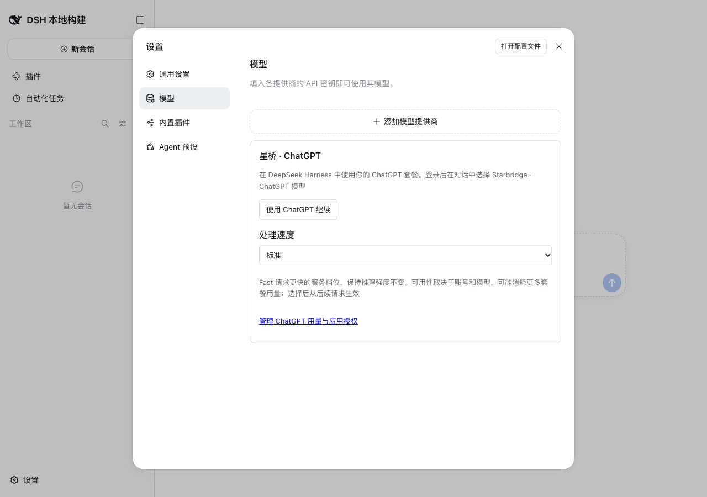

# 星桥 · Starbridge


在 **DeepSeek Harness（DSH）桌面端或 Web** 中使用 ChatGPT 浏览器授权登录，管理多个账号，并选择标准或 Fast 处理档位。本仓库包含插件源码、测试，以及接入 DSH 开源项目的构建脚本。

星桥是社区插件，并非 OpenAI 或 DeepSeek 官方产品。它不索取 ChatGPT 密码，不读取 Codex 的凭据。账号、模型和 Fast 使用资格由 OpenAI 决定。

## 支持版本

| 项目 | 已验证版本 |
| --- | --- |
| npm 插件 | `@kongpingan/dsh-starbridge@0.1.0-beta.6` |
| DSH 桌面端 / Web | `0.2.0-rc.2`、`0.2.1-alpha.2`、`0.2.1-rc.2` |
| 已验证系统 | macOS Apple Silicon |
| Windows / Linux | 尚未完成平台验证 |
| 源码构建 | Node.js 24+、Git、pnpm；固定 DSH 基线见 [integration/dsh.json](integration/dsh.json) |

插件 API 尚在演进。不要通过删除 peerDependencies 或添加版本豁免来解决不兼容；适配其他 DSH 版本后，应先运行安装和运行时测试，再增加支持范围。

## 在桌面端安装

1. 打开 **插件 → 安装**，填写 `@kongpingan/dsh-starbridge@0.1.0-beta.6`。
2. 启用插件。如果应用要求重启，先结束正在进行的任务。
3. 打开 **设置 → 模型 → 星桥 · ChatGPT**，点击 **使用 ChatGPT 继续**。
4. 在浏览器中完成官方授权，回到 DSH，在模型选择器中选取 **Starbridge · ChatGPT** 下有权使用的模型。

浏览器与 DSH Host 必须在同一台电脑上，授权使用临时 `127.0.0.1` 回调。Fast 从后续请求生效，不改变推理强度；它可能消耗更多套餐用量。



## 在 DSH 开源项目中使用

如果只想使用插件，无需修改 DSH 的代码。在对应版本的 DSH 项目根目录运行：

```sh
pnpm dsh plugin --profile web add --ignore-scripts @kongpingan/dsh-starbridge@0.1.0-beta.6
pnpm dsh --profile web
```

命令通过 DSH 的插件管理器安装并启用 bundle。已安装的独立 CLI 使用 `dsh` 替代 `pnpm dsh`。桌面端使用自己的 `desktop` 配置，CLI 的 `web` 配置与桌面插件安装相互独立。

详细说明见 [DSH 接入指南](docs/dsh-integration.md)。

## 修改源码与重新打包

本仓库使用 DSH 自身的类型生成、Remote 描述生成和 Client 打包流程，不维护另一套复制的框架。准备脚本会从官方仓库获取固定提交，在本仓库的 `.work/dsh` 中应用必要的集成补丁和插件源码；不会修改你已有的 DSH 仓库。

```sh
git clone https://github.com/kongxiaoan/dsh-starbridge.git
cd dsh-starbridge
npm run prepare:dsh
npm run build
npm test
```

构建产物位于 `dist/`。编辑 `overlay/` 下的源码后，再运行 `npm run build` 和 `npm test`。不要把 `.work/dsh` 当作源码归属目录：同步脚本会用 `overlay/` 覆盖其中对应文件。

[二次开发指南](docs/development.md)说明代码结构、测试、修改 OAuth / 模型 / UI、使用本地安装包和发布新版本的步骤。

## 仓库结构

| 位置 | 内容 |
| --- | --- |
| `overlay/packages/llm/starbridge/` | OAuth、账号存储、Remote 服务和模型路由 |
| `overlay/packages/client/ui-starbridge/` | 中文/英文界面、账号操作和处理速度控件 |
| `overlay/packages/llm/llm-pi-ai/src/` | 打包时复用的适配器修改，其他文件来自固定 DSH 基线 |
| `overlay/plugins/starbridge/` | npm 清单、bundle、构建脚本、发行文档及运行时探测 |
| `overlay/apps/web/tests/` | 浏览器测试和预期输出 |
| `integration/` | DSH 基线与工作区、类型索引、文档集成补丁 |
| `scripts/workspace.mjs` | 准备、同步、构建和验证入口 |

## 验证范围

已验证三个支持版本的正常 profile 安装、设置写入、授权发起/取消与回调释放；`0.2.0-rc.2` 和 `0.2.1-rc.2` 还完成了 Chrome 界面和卸载检查。真实账号授权与真实模型调用仍需要使用者登录验证，不能用模拟测试替代账号资格检查。

已知上游检查限制、源码迁移验证和测试命令记录在 [开发指南](docs/development.md)。

## 凭据与许可

令牌保存在 DSH Host 的现有凭据存储中，不传入 UI。卸载保留账号凭据；如需撤销授权，请先在插件中退出登录。不要在 Issue、提交或截图中包含令牌、验证码或 DSH 凭据目录。

MIT，见 [LICENSE](LICENSE) 与 [NOTICE](NOTICE)。[npm 包](https://www.npmjs.com/package/@kongpingan/dsh-starbridge) · [反馈问题](https://github.com/kongxiaoan/dsh-starbridge/issues)
